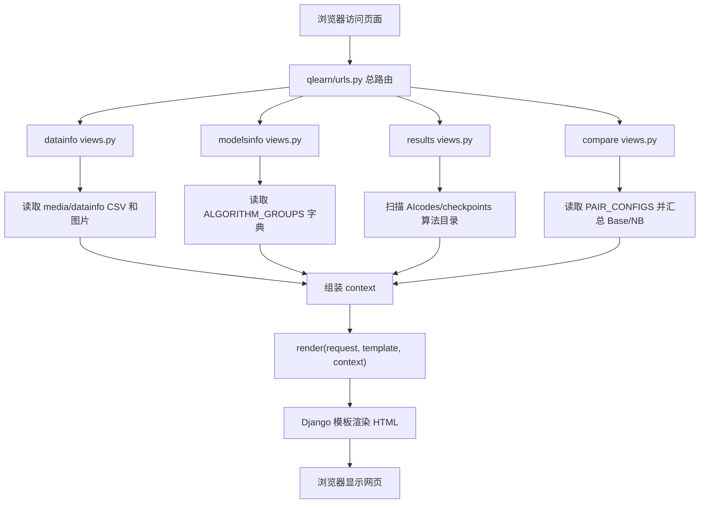

# Qlearn Django 项目业务逻辑与代码讲解

这份文档按答辩视角整理：重点解释“网页是怎么显示出来的”“页面内容从哪里来”“前端和后端怎么联系”“每个业务模块的代码逻辑是什么”。

## 1. 项目一句话说明

本项目是一个离线强化学习实验展示系统。

训练脚本在 `AIcodes/` 中提前运行，生成模型文件、训练日志 CSV 和曲线图片；Django 项目不负责实时训练模型，而是读取这些已有产物，把它们组织成网页展示出来。

整体流程是：

```text
HalfCheetah 数据集
    -> AIcodes/*.py 训练脚本
    -> AIcodes/checkpoints/算法名/ 生成结果文件
    -> Django views.py 读取文件并组织 context
    -> templates/*.html 用模板变量渲染网页
    -> 浏览器看到数据集、算法说明、结果图和对比表
```

## 2. Django 如何把网页显示出来

Django 显示一个页面的基本链路是：

```text
浏览器访问 URL
    -> qlearn/urls.py 匹配总路由
    -> include 到某个 app 的 urls.py
    -> 调用对应 views.py 函数
    -> view 准备 context 字典
    -> render(request, template, context)
    -> Django 模板把 {{ 变量 }} 和  渲染成 HTML
    -> 返回给浏览器
```

项目总路由在 `qlearn/urls.py`：

```python
urlpatterns = [
    path('admin/', admin.site.urls),
    path("datainfo/", include("apps.datainfo.urls")),
    path("modelsinfo/", include("apps.modelsinfo.urls")),
    path("results/", include("apps.results.urls")),
    path("compare/", include("apps.compare.urls")),
]
```

这表示：

| 浏览器路径 | 进入哪个 app | 作用 |
| --- | --- | --- |
| `/datainfo/` | `apps.datainfo` | 数据集介绍 |
| `/modelsinfo/` | `apps.modelsinfo` | 算法原理介绍 |
| `/results/` | `apps.results` | 单个算法训练结果 |
| `/compare/` | `apps.compare` | Base / NB 算法对比 |
| `/admin/` | Django admin | 后台管理 |

所以答辩时可以说：项目采用 Django 的“路由 -> 视图 -> 模板”模式，后端负责准备页面数据，前端模板负责展示。

## 3. 前端和后端是怎么联系的

这个项目不是前后端分离项目，没有 Vue/React，也没有单独的 REST API。

它主要使用 Django 服务端模板渲染，也就是：

```text
前端请求一个 URL
后端一次性生成完整 HTML
浏览器直接显示 HTML
```

前端和后端的联系主要靠三种方式：

1. URL 路由：例如访问 `/results/?algorithm=BC`。
2. GET 参数：例如 `algorithm=BC` 或 `pair=td3`。
3. Django 模板变量：例如 `{{ selected_algorithm }}`、`{{ metric_rows }}`、``。

### 3.1 模板变量如何传给前端

后端 view 中一般会写：

```python
context = {
    'selected_algorithm': selected,
    'summary_cards': summary_cards,
    'main_charts': main_charts,
}
return render(request, 'results/results.html', context)
```

模板中就可以直接使用：

```html
{{ selected_algorithm }}


    {{ card.label }}
    {{ card.value }}

```

这就是后端数据传到前端页面的核心方式。

### 3.2 页面选择框如何触发后端逻辑

例如 `modelsinfo` 页面有算法对选择框：

```html
<select class="form-control" id="pair-select">
    
        <option value="{{ pair.key }}" selected>
            {{ pair.title }}
        </option>
    
</select>

<script>
(function () {
    $('#pair-select').on('change', function () {
        window.location.href = '?pair=' + $(this).val();
    });
})();
</script>
```

这里的逻辑是：

```text
用户选择 CQL
    -> JavaScript 把浏览器地址改成 /modelsinfo/?pair=cql
    -> 浏览器重新请求后端
    -> views.py 读取 request.GET["pair"]
    -> 后端选择 cql 对应的数据
    -> 重新渲染页面
```

所以它不是 Ajax 局部刷新，而是通过 GET 参数重新请求整个页面。

## 4. settings.py 里和业务相关的配置

`qlearn/settings.py` 主要配置了 app、模板、静态文件、媒体文件和后台菜单。

### 4.1 app 注册

```python
INSTALLED_APPS = [
    'simpleui',
    'django.contrib.admin',
    ...
    'apps.datainfo',
    'apps.modelsinfo',
    'apps.results',
    'apps.compare',
]
```

这里说明项目的业务模块有四个：

```text
datainfo    数据集展示
modelsinfo  算法说明
results     单算法结果展示
compare     算法对比
```

### 4.2 模板位置

```python
TEMPLATES = [
    {
        'DIRS': [os.path.join(BASE_DIR, 'templates')],
        'APP_DIRS': True,
    }
]
```

因此模板文件统一放在：

```text
templates/datainfo/halfcheetah_overview.html
templates/modelsinfo/modelsinfo.html
templates/results/results.html
templates/compare/compare.html
```

### 4.3 静态和媒体文件

```python
STATIC_URL = '/static/'
STATICFILES_DIRS = [
    os.path.join(BASE_DIR, 'static')
]

MEDIA_ROOT = os.path.join(BASE_DIR, 'media')
MEDIA_URL = '/media/'
```

含义：

| 类型 | 用途 | 目录 |
| --- | --- | --- |
| static | Bootstrap、jQuery 等前端库 | `static/` |
| media | 数据集展示用 CSV、图片 | `media/` |

在模板中，Bootstrap 这样引入：

```html

<link rel="stylesheet" href="">
```

`media` 文件在开发环境下由 `qlearn/urls.py` 追加静态访问规则：

```python
if settings.DEBUG:
    urlpatterns += static(
        settings.MEDIA_URL,
        document_root=settings.MEDIA_ROOT
    )
```

所以 `/media/datainfo/actions_subplots.png` 这类路径可以被浏览器直接访问。

## 5. datainfo：数据集介绍页逻辑

入口路由在 `apps/datainfo/urls.py`：

```python
urlpatterns = [
    path('', views.halfcheetah_overview, name='index'),
    path('halfcheetah-medium-v2/', views.halfcheetah_overview, name='halfcheetah_medium_v2'),
]
```

两个 URL 都调用同一个视图函数：

```python
def halfcheetah_overview(request):
    ...
    return render(request, 'datainfo/halfcheetah_overview.html', context)
```

### 5.1 后端准备哪些内容

在 `apps/datainfo/views.py` 里，先定义固定文件名：

```python
MEDIA_SUBDIR = 'datainfo'
CSV_FILENAME = 'halfcheetah_dataset.csv'
OBS_IMG_FILENAME = 'observations_subplots.png'
ACT_IMG_FILENAME = 'actions_subplots.png'
REWARD_IMG_FILENAME = 'reward_terminal_subplots.png'
```

也就是说这个页面默认从下面目录读取展示文件：

```text
media/datainfo/halfcheetah_dataset.csv
media/datainfo/observations_subplots.png
media/datainfo/actions_subplots.png
media/datainfo/reward_terminal_subplots.png
```

然后定义数据字段说明：

```python
FIELD_ROWS = [
    {
        'field_name': 'observations',
        'csv_mapping': 'obs_0 ~ obs_16',
        'shape_desc': '[N, 17]',
        'meaning': '环境状态向量，共 17 维',
        'used_by': '全部算法',
    },
    ...
]
```

这些不是数据库数据，而是代码中写好的说明文字，最后会传给模板表格展示。

### 5.2 文件信息怎么生成

代码里用 `_media_file_info()` 统一生成文件信息：

```python
def _media_file_info(filename):
    abs_path = os.path.join(settings.MEDIA_ROOT, MEDIA_SUBDIR, filename)
    url = '{}{}/{}'.format(settings.MEDIA_URL, MEDIA_SUBDIR, filename)
    exists = os.path.exists(abs_path)
    return {
        'name': filename,
        'path': abs_path,
        'url': url,
        'exists': exists,
        'size': _human_size(os.path.getsize(abs_path)) if exists else '-',
    }
```

这个函数把一个文件变成前端能用的数据结构：

| 字段 | 含义 |
| --- | --- |
| `name` | 文件名 |
| `path` | 服务器本地绝对路径 |
| `url` | 浏览器访问路径 |
| `exists` | 文件是否存在 |
| `size` | 文件大小 |

### 5.3 CSV 预览怎么做

```python
def _read_csv_preview(csv_path, preview_rows=8):
    with open(csv_path, 'r', encoding='utf-8') as f:
        reader = csv.reader(f)
        columns = next(reader, [])
        for index, row in enumerate(reader):
            if index < preview_rows:
                rows.append(row)
            row_count = index + 1
```

逻辑是：

```text
打开 CSV
    -> 读取第一行作为列名
    -> 只保存前 8 行作为页面预览
    -> 顺便统计总行数
```

### 5.4 context 怎么传给模板

`halfcheetah_overview()` 最后组织 context：

```python
context = {
    'dataset': {
        'title': 'HalfCheetah Medium v2',
        'obs_dim': 17,
        'action_dim': 6,
        'csv_column_count': len(CSV_COLUMNS),
        'csv_row_count': csv_row_count,
    },
    'files': {
        'csv': csv_file,
        'obs_img': obs_img,
        'act_img': act_img,
        'reward_img': reward_img,
    },
    'missing_files': missing_files,
    'preview_columns': preview_columns,
    'preview_rows': preview_rows,
    'field_rows': FIELD_ROWS,
    'csv_groups': CSV_GROUPS,
    'algo_requirements': ALGO_REQUIREMENTS,
}
```

模板 `templates/datainfo/halfcheetah_overview.html` 中这样使用：

```html
<div class="summary-value">{{ dataset.obs_dim }}</div>
<div class="summary-value">{{ dataset.action_dim }}</div>


    <tr>
        <td><code>{{ row.field_name }}</code></td>
        <td>{{ row.csv_mapping }}</td>
        <td>{{ row.meaning }}</td>
        <td>{{ row.used_by }}</td>
    </tr>

```

所以 `datainfo` 页面本质是：

```text
后端读取 media/datainfo 中的 CSV 和图片
后端组装数据集说明 context
前端模板把 context 渲染成统计卡片、表格和图片预览
```

## 6. modelsinfo：算法说明页逻辑

入口路由在 `apps/modelsinfo/urls.py`：

```python
urlpatterns = [
    path('', views.modelsinfo, name='modelsinfo'),
]
```

后端核心在 `apps/modelsinfo/views.py`。

### 6.1 页面内容从哪里来

算法介绍页的大量文字不是从数据库读取，而是直接写在 Python 字典 `ALGORITHM_GROUPS` 中：

```python
ALGORITHM_GROUPS = {
    'bc': {
        'key': 'bc',
        'title': 'BC / BC_NB',
        'base_name': 'BC',
        'nb_name': 'BC_NB',
        'summary': '这一组方法适合新手理解...',
        'sections': {
            'beginner': {...},
            'flow': {...},
            'design': {...},
            'params': {...},
            'code': {...},
            'io': {...},
            'compare': {...},
            'conclusion': {...},
        },
    },
    ...
}
```

这里每个算法对都被组织成同样结构：

| section | 页面含义 |
| --- | --- |
| `beginner` | 小白先看 |
| `flow` | 方法流程 |
| `design` | 核心设计 |
| `params` | 参数说明 |
| `code` | 代码块讲解 |
| `io` | 输入输出与产物 |
| `compare` | Base / NB 对比 |
| `conclusion` | 小结 |

### 6.2 用户选择算法对后发生什么

视图函数：

```python
def modelsinfo(request):
    pair = request.GET.get('pair', 'bc')
    if pair not in ALGORITHM_GROUPS:
        pair = 'bc'

    current = ALGORITHM_GROUPS[pair]
    pairs = [ALGORITHM_GROUPS[key] for key in ['bc', 'cql', 'ddpg', 'sac', 'td3']]

    context = {
        'page_title': '算法介绍',
        'pairs': pairs,
        'current_pair': current,
        'current_key': pair,
        'section_order': SECTION_ORDER,
    }
    return render(request, 'modelsinfo/modelsinfo.html', context)
```

逻辑是：

```text
默认 pair = bc
如果 URL 是 /modelsinfo/?pair=sac
    -> request.GET.get('pair') 得到 sac
    -> current = ALGORITHM_GROUPS['sac']
    -> 模板展示 SAC / SAC_NB 的说明
```

### 6.3 模板如何展示算法内容

模板文件是 `templates/modelsinfo/modelsinfo.html`。

顶部选择框：

```html

    <option value="{{ pair.key }}" selected>
        {{ pair.title }}
    </option>

```

小白先看：

```html

    <h3 class="section-title">{{ s.title }}</h3>
    <p class="section-lead">{{ s.lead }}</p>
    
        <div class="soft-card"><p>{{ item }}</p></div>
    

```

核心设计：

```html

    <h4>{{ card.title }}</h4>
    <span class="design-label">通俗理解：</span>
    {{ card.plain }}
    <span class="design-label tech">技术对应：</span>
    {{ card.technical }}

```

所以 `modelsinfo` 页面可以这样讲：

```text
后端用 ALGORITHM_GROUPS 维护算法讲解数据
用户通过 ?pair=xxx 选择算法对
后端取出对应 group
模板按 section 渲染成 tab 页面
```

## 7. results：单算法结果展示页逻辑

入口路由在 `apps/results/urls.py`：

```python
urlpatterns = [
    path('', views.results_overview, name='results'),
    path('file/<str:algorithm>/<path:filename>/', views.result_file, name='result_file'),
]
```

这里有两个功能：

| URL | 作用 |
| --- | --- |
| `/results/` | 展示算法结果页面 |
| `/results/file/BC/train_val_loss.png/` | 查看或下载某个结果文件 |

### 7.1 算法元信息从哪里来

`apps/results/views.py` 里有 `ALGORITHM_META`：

```python
ALGORITHM_META = {
    'BC': {
        'title': 'BC',
        'nickname': '行为克隆',
        'category': '模仿学习 / 基线方法',
        'summary': '直接学习“状态到动作”的映射...',
        'primary_metrics': [
            ('val_loss', '验证误差'),
            ('mse', '验证集 MSE'),
            ('mae', '验证集 MAE'),
        ],
        'main_charts': ['train_val_loss.png'],
        'more_charts': ['lr_curve.png'],
        'log_files': ['training_log.csv', 'evaluation_summary.csv'],
    },
    ...
}
```

它告诉页面：

```text
这个算法叫什么
属于什么类别
摘要怎么写
优先显示哪些指标
主图是哪几张
训练日志文件叫什么
```

### 7.2 自动发现算法目录

结果目录根路径：

```python
def _results_root():
    custom_root = getattr(settings, 'RESULTS_ROOT', None)
    if custom_root:
        return custom_root
    return os.path.join(settings.BASE_DIR, 'AIcodes/checkpoints')
```

自动扫描算法目录：

```python
def _discover_algorithms():
    root = _results_root()
    if not os.path.isdir(root):
        return []
    names = []
    for name in sorted(os.listdir(root)):
        full = os.path.join(root, name)
        if os.path.isdir(full):
            names.append(name)
    return names
```

也就是说页面不是写死只显示哪些算法目录，而是从：

```text
AIcodes/checkpoints/
```

下面扫描子目录，例如：

```text
BC
BC_NB
CQL
CQL_NB
DDPG
DDPG_NB
SAC
SAC_NB
TD3
TD3_NB
```

### 7.3 用户选择算法后发生什么

核心视图：

```python
def results_overview(request):
    algorithms = _discover_algorithms()
    selected = request.GET.get('algorithm')
    if not selected or selected not in algorithms:
        selected = algorithms[0] if algorithms else None
```

逻辑：

```text
访问 /results/
    -> 自动选择第一个算法目录

访问 /results/?algorithm=TD3_NB
    -> selected = TD3_NB
    -> 读取 AIcodes/checkpoints/TD3_NB/ 下的文件
```

### 7.4 训练日志和评估文件怎么读

代码会根据 `ALGORITHM_META[selected]['log_files']` 找日志文件：

```python
for name in meta.get('log_files', []):
    path = os.path.join(_algorithm_dir(selected), name)
    if os.path.exists(path):
        if name == 'evaluation_summary.csv':
            eval_df = _safe_read_csv(path)
        else:
            log_df = _safe_read_csv(path)
            break
```

CSV 读取使用 pandas：

```python
def _safe_read_csv(csv_path):
    try:
        return pd.read_csv(csv_path)
    except Exception:
        return None
```

如果读取失败，不会直接报错，而是返回 `None`，页面尽量显示已有内容。

### 7.5 摘要指标怎么生成

```python
def _build_summary_cards(algorithm, meta, log_df, eval_df):
    last_log = _last_record(log_df)
    eval_val = _evaluation_val_record(eval_df)

    cards = []
    for field, label in meta.get('primary_metrics', []):
        value = None
        if field in eval_val:
            value = eval_val.get(field)
        elif field in last_log:
            value = last_log.get(field)
        cards.append({
            'label': label,
            'value': _format_metric_value(value) if value is not None else '-',
        })
    return cards
```

逻辑是：

```text
从评估汇总或最后一条训练日志中找关键指标
    -> 格式化数字
    -> 生成 summary_cards
    -> 模板展示成顶部指标卡片
```

模板中：

```html

    <div class="metric-card">
        <div class="label-text">{{ card.label }}</div>
        <div class="value-text">{{ card.value }}</div>
    </div>

```

### 7.6 图表怎么显示

后端根据算法配置找到主图：

```python
main_charts = _inject_chart_urls(
    selected,
    _build_chart_items(selected, meta.get('main_charts', []))
)
```

模板中通过 Django URL 生成图片地址：

```html

```

这里不是直接访问静态文件，而是访问：

```text
/results/file/<算法名>/<文件名>/
```

然后由后端 `result_file()` 返回文件。

### 7.7 文件查看和下载怎么做

```python
def result_file(request, algorithm, filename):
    file_path = _safe_join_algorithm_file(algorithm, filename)
    content_type, _ = mimetypes.guess_type(file_path)
    content_type = content_type or 'application/octet-stream'
    as_attachment = request.GET.get('download') == '1'
    response = FileResponse(open(file_path, 'rb'), content_type=content_type)
    if as_attachment:
        response['Content-Disposition'] = 'attachment; filename="{}"'.format(os.path.basename(file_path))
    else:
        response['Content-Disposition'] = 'inline; filename="{}"'.format(os.path.basename(file_path))
    return response
```

如果访问：

```text
/results/file/BC/train_val_loss.png/
```

浏览器内联显示图片。

如果访问：

```text
/results/file/BC/train_val_loss.png/?download=1
```

浏览器下载文件。

### 7.8 安全路径检查

文件接口先做路径安全检查：

```python
def _safe_join_algorithm_file(algorithm, filename):
    algo_dir = _algorithm_dir(algorithm)
    target = os.path.abspath(os.path.join(algo_dir, filename))
    if not target.startswith(algo_dir + os.sep):
        raise Http404('非法文件路径')
    if not os.path.exists(target):
        raise Http404('文件不存在')
    return target
```

这能防止用户通过类似 `../../settings.py` 这种路径读取结果目录外的文件。

### 7.9 results 页面总结

`results` 的完整链路是：

```text
浏览器访问 /results/?algorithm=BC
    -> results_overview()
    -> 扫描 AIcodes/checkpoints
    -> 确定 selected_algorithm = BC
    -> 读取 BC 目录下的 CSV、PNG、PT 文件
    -> 用 pandas 读取 CSV 指标
    -> 生成状态提示、摘要卡片、图表列表、文件列表
    -> render 到 templates/results/results.html
    -> 浏览器看到单算法结果页
```

## 8. compare：Base / NB 对比页逻辑

入口路由在 `apps/compare/urls.py`：

```python
urlpatterns = [
    path('', views.compare_view, name='compare'),
    path('asset/<path:relative_path>/', views.compare_asset, name='asset'),
]
```

两个功能：

| URL | 作用 |
| --- | --- |
| `/compare/` | 展示算法对比页 |
| `/compare/asset/BC/train_val_loss.png/` | 返回对比页需要的图片或文件 |

### 8.1 对比配置从哪里来

`apps/compare/views.py` 中有 `PAIR_CONFIGS`：

```python
PAIR_CONFIGS = OrderedDict([
    ('BC', {
        'title': 'BC / BC_NB',
        'base_dir': 'BC',
        'nb_dir': 'BC_NB',
        'family': '行为克隆',
        'beginner': '这一组最适合初学者理解...',
        'difference': 'NB 版增加了 return-weighted 权重设计...',
        'core_charts': [
            ('loss', '损失曲线', ['train_val_loss.png', 'train_test_loss.png']),
            ('lr', '学习率曲线', ['lr_curve.png']),
        ],
        'primary_metrics': [
            {'key': 'val_loss', 'label': '最终验证损失', 'source': 'train', 'pref': 'lower'},
            ...
        ],
    }),
    ...
])
```

这里定义了每组对比：

```text
Base 目录是哪一个
NB 目录是哪一个
这组算法属于什么家族
关键差异怎么解释
对比哪些指标
展示哪些核心图表
```

### 8.2 用户选择算法对后发生什么

```python
def compare_view(request):
    pair_key = request.GET.get('pair', 'BC')
    if pair_key not in PAIR_CONFIGS:
        pair_key = 'BC'

    pair_cfg = PAIR_CONFIGS[pair_key]
    base_summary = _method_summary(pair_cfg['base_dir'])
    nb_summary = _method_summary(pair_cfg['nb_dir'])

    metric_rows = _build_metric_rows(pair_cfg, base_summary, nb_summary)
    chart_rows = _build_chart_rows(pair_cfg, base_summary, nb_summary)
    conclusion = _compare_conclusion(pair_key, pair_cfg, base_summary, nb_summary, metric_rows)
```

逻辑：

```text
访问 /compare/
    -> 默认 pair = BC

访问 /compare/?pair=SAC
    -> 读取 PAIR_CONFIGS['SAC']
    -> base_dir = SAC
    -> nb_dir = SAC_NB
    -> 分别汇总两个目录
    -> 生成指标对比、曲线对比、一句话结论
```

### 8.3 单个算法目录如何汇总

```python
def _method_summary(method_dir_name):
    root = _checkpoints_dir()
    dir_path = os.path.join(root, method_dir_name)
    status_key, status_text, status_class = _status_info(dir_path)
    train_csv_name, train_df = _get_training_df(dir_path)
    eval_df = _get_eval_df(dir_path)

    train_last = _series_tail_dict(train_df)
    eval_val = _get_val_row(eval_df) or {}
```

它会做几件事：

```text
检查目录是否存在
检查 best_model.pt 是否存在
读取 training_log.csv / training_records.csv / training_history.csv
读取 evaluation_summary.csv
取训练日志最后一行
取评估表里的 val 行
收集图片文件和全部文件
检测是否有 NaN
```

### 8.4 关键指标如何比较

```python
def _build_metric_rows(pair_cfg, base_summary, nb_summary):
    rows = []
    for item in pair_cfg['primary_metrics']:
        ...
        if base_val is not None and nb_val is not None:
            diff = float(nb_val) - float(base_val)
            diff_text = _fmt_value(diff)

        if pref == 'lower':
            winner = 'NB 更优' if nv < bv else ('Base 更优' if bv < nv else '接近')
        elif pref == 'higher':
            winner = 'NB 更优' if nv > bv else ('Base 更优' if bv > nv else '接近')
        else:
            winner = '需结合业务解释'
```

含义：

```text
读取 Base 指标
读取 NB 指标
计算 NB - Base
根据 pref 判断哪个更优
    lower：越小越好，例如 loss
    higher：越大越好
    neutral：不能只看大小，需要结合业务解释
```

模板中展示：

```html
<td>{{ row.label }}</td>
<td>{{ row.base_value }}</td>
<td>{{ row.nb_value }}</td>
<td>{{ row.difference }}</td>
<td>{{ row.winner }}</td>
```

### 8.5 曲线图如何对比

```python
def _build_chart_rows(pair_cfg, base_summary, nb_summary):
    rows = []
    for key, label, candidates in pair_cfg['core_charts']:
        base_chart = None
        nb_chart = None
        for fname in candidates:
            bpath = os.path.join(base_summary['dir_path'], fname)
            npath = os.path.join(nb_summary['dir_path'], fname)
            ...
```

逻辑是：

```text
对每一种图表类型，准备候选文件名
    -> Base 目录里找到就作为 base_chart
    -> NB 目录里找到就作为 nb_chart
    -> 模板左右两列展示
```

### 8.6 compare 页面总结

`compare` 完整链路：

```text
浏览器访问 /compare/?pair=TD3
    -> compare_view()
    -> 读取 PAIR_CONFIGS['TD3']
    -> 汇总 TD3 目录
    -> 汇总 TD3_NB 目录
    -> 计算关键指标差值和优劣判断
    -> 找到对应曲线图
    -> 生成一句话结论
    -> render 到 templates/compare/compare.html
```

## 9. AIcodes：训练脚本和展示系统的关系

`AIcodes/` 下的脚本是真正的算法实现：

```text
BC.py
BC_NB.py
CQL.py
CQL_NB.py
DDPG.py
DDPG_NB.py
SAC.py
SAC_NB.py
TD3.py
TD3_NB.py
```

它们训练完成后输出到：

```text
AIcodes/checkpoints/算法名/
```

典型输出包括：

| 文件 | 含义 |
| --- | --- |
| `best_model.pt` | 最佳模型参数 |
| `train_config.json` | 训练配置 |
| `training_log.csv` / `training_records.csv` / `training_history.csv` | 训练日志 |
| `evaluation_summary.csv` | 评估汇总 |
| `*.png` | 损失曲线、Q 值曲线、奖励曲线等 |

Django 的 `results` 和 `compare` 页面就是读取这些文件展示。

### 9.1 BC 和 BC_NB

`BC.py` 读取：

```python
obs = torch.tensor(f["observations"][:], dtype=torch.float32)
actions = torch.tensor(f["actions"][:], dtype=torch.float32)
```

训练核心：

```python
pred_act = model(batch_obs)
loss = loss_fn(pred_act, batch_act)
loss.backward()
optimizer.step()
```

含义：

```text
输入状态 s
预测动作 pi(s)
和数据集动作 a 比较误差
让模型越来越像数据集里的动作
```

`BC_NB.py` 多了样本权重：

```python
sample_loss = per_sample_loss(pred_act, batch_act, config.loss_type)
loss = (sample_loss * batch_w).mean()
```

含义：

```text
高回报 episode 的样本权重大
这些样本的动作误差会被放大
模型更重视高质量轨迹
```

### 9.2 CQL 和 CQL_NB

`CQL.py` 的核心是保守 Q 学习：

```python
q_rand = critic(random_actions)
q_pi = critic(policy_actions)
q_data = critic(data_actions)
penalty = logsumexp(q_rand, q_pi) - q_data.mean()
```

含义：

```text
不要让数据集外的动作 Q 值过高
让 critic 更相信数据集中真实出现过的动作
减少离线强化学习中的过估计问题
```

`CQL_NB.py` 进一步把 next policy action 也加入 penalty：

```python
next_pi_action = (actor(s_next) + noise).clamp(-1.0, 1.0)
q_next_pi = critic(torch.cat([s_next, next_pi_action], dim=1))
cat_q = torch.cat([q_rand, q_pi, q_next_pi], dim=1)
```

含义：

```text
不仅约束当前策略动作
还约束下一状态策略动作
并用噪声平滑目标动作
```

### 9.3 DDPG / TD3 / SAC 系列

这些都是 actor-critic 思路：

```text
actor：根据状态输出动作
critic：评价状态 + 动作的 Q 值
target network：慢慢更新，稳定训练目标
```

TD 目标一般是：

```text
target_q = reward + gamma * (1 - done) * next_q
```

`TD3.py` 中：

```python
target_Q = reward + (1 - done) * self.gamma * target_Q
critic_loss = MSE(current_Q1, target_Q) + MSE(current_Q2, target_Q)
actor_loss = -self.critic.q1_forward(state, self.actor(state)).mean()
```

含义：

```text
critic 学会估计动作价值
actor 尝试输出 critic 认为价值高的动作
```

`TD3_NB.py` 中：

```python
q_term = -lam * q_pi.mean()
bc_term = self.bc_coef * mse_loss(pi, action)
actor_loss = q_term + bc_term
```

含义：

```text
q_term：鼓励 actor 输出高 Q 动作
bc_term：约束 actor 不要偏离离线数据动作太远
NB 版本更适合离线数据，因为不能在线试错
```

`SAC_NB.py` 中：

```python
sac_loss = (self.alpha.detach() * log_prob - q_pi).mean()
bc_loss = mse_loss(sampled_action, action)
actor_loss = sac_loss + self.cfg.bc_coef * bc_loss
```

含义：

```text
SAC 原本追求最大熵策略优化
NB 版本额外加入行为克隆约束
策略既要考虑 Q 值和熵，也不能离数据动作太远
```

## 10. 四个页面之间的业务关系

可以把项目理解成一个实验展示闭环：

```text
datainfo
    说明数据从哪里来、字段是什么、哪些算法会用哪些字段

modelsinfo
    说明每个算法的原理、流程、参数、代码模块和 Base/NB 差异

results
    展示某一个算法训练完成后的实际结果

compare
    把 Base 和 NB 成对比较，回答“改进版有什么变化”
```

答辩时可以这样串起来：

```text
首先，datainfo 页面说明实验使用 HalfCheetah medium-v2 离线数据集；
然后，modelsinfo 页面解释 BC、CQL、DDPG、SAC、TD3 及其 NB 改进版的算法逻辑；
接着，AIcodes 中的训练脚本生成 checkpoint、日志和图表；
最后，results 和 compare 页面读取这些产物，分别展示单算法结果和 Base/NB 对比。
```

## 11. 这个项目为什么没有自定义 models.py

项目中没有看到自定义业务模型表，说明它不是典型 CRUD 系统。

它的数据主要来自三类文件：

| 数据来源 | 用途 |
| --- | --- |
| `media/datainfo/*.csv/*.png` | 数据集页面展示 |
| `apps/modelsinfo/views.py` 中的字典 | 算法说明文字 |
| `AIcodes/checkpoints/*` | 训练结果、模型、曲线图 |

SQLite 数据库 `db.sqlite3` 更多是给 Django admin、用户、权限这些默认功能使用。

所以答辩时可以说：

```text
本系统的业务数据不是通过数据库增删改查维护，而是以实验产物文件和 Python 配置字典为主。Django 的作用是把这些文件和结构化说明组织成可浏览、可对比、可下载的展示页面。
```

## 12. 可以直接背的答辩讲法

### 12.1 项目架构

本项目采用 Django 服务端模板渲染架构。浏览器访问 URL 后，Django 路由把请求分发到对应 app 的 view 函数；view 函数读取本地实验文件或 Python 配置字典，组装成 context；最后通过 `render()` 交给 HTML 模板渲染成网页返回给浏览器。

### 12.2 前后端交互

前端没有使用前后端分离框架，而是使用 Bootstrap、jQuery 和 Django Template。用户切换算法时，页面通过 GET 参数重新请求后端，比如 `/results/?algorithm=BC` 或 `/compare/?pair=TD3`。后端根据参数选择不同算法目录或算法配置，再重新渲染页面。

### 12.3 数据流

数据集展示页读取 `media/datainfo` 下的 CSV 和图片；算法说明页读取 `apps/modelsinfo/views.py` 中的 `ALGORITHM_GROUPS`；结果展示页和对比页读取 `AIcodes/checkpoints` 下的模型、日志和曲线图。整个系统围绕“离线数据集 -> 算法训练 -> 结果产物 -> Django 展示”展开。

### 12.4 业务重点

系统重点不是在线训练，而是把离线强化学习实验结果结构化展示出来。它能让用户先理解数据字段，再理解算法原理，然后查看单算法训练结果，最后比较 Base 和 NB 改进版之间的差异。

## 13. 代码阅读顺序建议

如果你要从代码角度准备答辩，建议按这个顺序看：

```text
1. qlearn/urls.py
   看总路由如何分发到四个 app

2. apps/datainfo/views.py
   看数据集页面如何读取 media 文件并生成 context

3. apps/modelsinfo/views.py
   看算法说明内容如何通过 ALGORITHM_GROUPS 组织

4. apps/results/views.py
   看单算法结果如何扫描 checkpoints、读取 CSV、生成图表和下载链接

5. apps/compare/views.py
   看 Base/NB 如何按 PAIR_CONFIGS 做指标和曲线对比

6. templates/*/*.html
   看模板如何使用 {{ 变量 }} 和  展示后端传来的数据

7. AIcodes/*.py
   看训练脚本如何生成 Django 要展示的 checkpoint、CSV 和 PNG
```

## 14. 最核心的一张流程图



